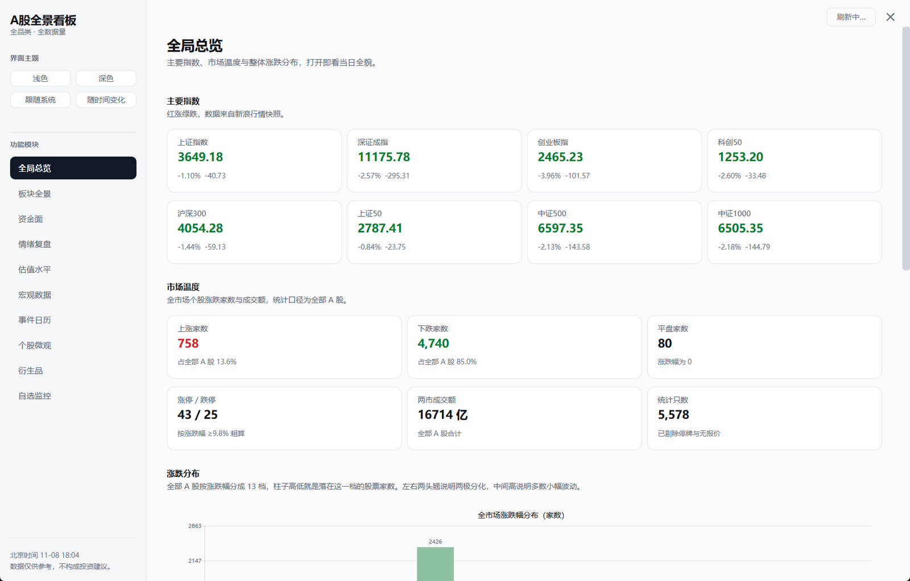
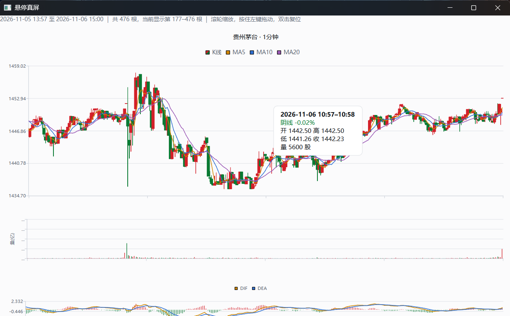
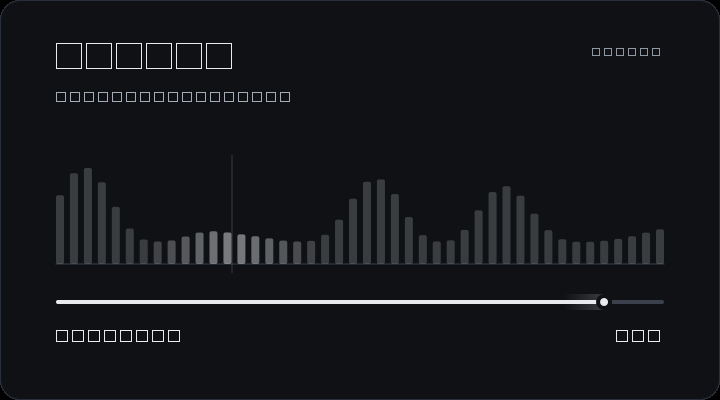

# A股全景看板 · 桌面版

一个不依赖浏览器的 A 股行情软件。双击打开就是 Windows 原生窗口，不启动本地服务、不占端口、不用在地址栏里敲 `127.0.0.1`。

十个模块，界面全中文，红涨绿跌。数据取自新浪、东方财富、申万等公开接口，每个模块都自带降级链：主源挂了换备源，备源也挂了还能用本地离线库合成。

**本项目只供个人学习与市场复盘使用，不构成任何投资建议，也不接实盘。**



## 用途

**拿来学。** 一个能跑通的桌面端样本：PySide6 的窗口、页面栈、四套主题、自绘组件（K 线、热力图、色标、开屏），加上多源降级、后台单线程取数、打包成 exe 的完整流程。想学 Qt 或者想自己拼一个类似的看板，可以直接读 `应用/` 下的代码，每个组件的取舍都写在 `docs/使用说明.md` 里。

**拿来回看盘面。** 收盘之后把当天的数据摆在一起看：哪些板块在动、资金进了哪儿、涨跌停和连板是什么结构、估值处在什么分位、后面几天有什么事件。它解决的是「今天这一天到底发生了什么」，不是「明天买什么」。

**不做什么。** 不荐股、不给买卖点、不生成交易信号、不接券商接口、不代客理财，也不对外提供行情分发或收费服务。仓库里没有、也不打算加任何形式的实盘下单功能。

## 它能看什么

| 模块 | 看什么 |
| --- | --- |
| 全局总览 | 主要指数、涨跌家数、涨跌停、成交额，全市场涨跌幅分布，申万二级行业热力图 |
| 板块全景 | 行业 / 概念 / 地域三套体系，热力图、板块列表、下钻成分股、板块 K 线 |
| 资金面 | 个股与概念资金流、北向、两融余额走势 |
| 情绪复盘 | 涨停池、连板梯队、龙虎榜、市场情绪温度 |
| 估值水平 | 板块与行业 PE/PB 分位、个股估值曲线 |
| 宏观数据 | PMI、CPI、PPI、M2、国债收益率曲线 |
| 事件日历 | 业绩预告、限售解禁、股东户数 |
| 个股微观 | 日/周/月与 1/5/15/30/60 分钟 K 线，MACD、KDJ、均线，缩放拖动 |
| 衍生品 | 股指期货、ETF、可转债 |
| 自选池 | 自己维护的代码列表，一屏看涨跌 |

## 两处细节

鼠标压在一分钟 K 线的任意一根上，旁边会浮出一张读数卡，写明这根 K 线覆盖的时间段，例如 `2026-11-06 10:57–10:58`：



区间取法和它为什么不用系统提示框，写在 [docs/使用说明.md](docs/使用说明.md) 里：新浪的分钟线标签打在区间**结束**时刻，所以一根 10:58 的分钟线覆盖 10:57–10:58；11:30 之后那一根从 13:00 算起，不把午休算进去。


)

右上角的「刷新」按一次，清掉内存缓存，把所有打开过的页面按上次的参数重新取一遍数。



## 跑起来

需要 Python 3.10 以上。

```bat
python -m pip install -r requirements.txt
python 运行.py
```

七个依赖：PySide6、pandas、numpy、akshare、requests、openpyxl、XlsxWriter。

`数据/` 目录里是离线板块库，不进版本库。没有它也能跑，只是「板块全景」下钻会空；想补上就执行一次：

```bat
python build_sector.py
```

大约 10–15 分钟，中途 Ctrl+C 再重跑会跳过已完成的板块。

想要不装 Python 的独立程序，用 PyInstaller 打成 onedir 文件夹版，方法见使用说明第八节。

## 目录

```
运行.py              双击启动（带依赖检查）
main.py              程序入口
config.py            板块映射、缓存时长、路径
data_fetcher.py      行情、K 线、交易日历
fetch_*.py           七个模块的取数脚本
data_export.py       导出 CSV / Excel
build_sector.py      重建离线板块库
应用/
  主窗口.py          左侧导航 + 右侧页面栈
  主题.py            浅色 / 深色两套调色板与 QSS
  后台任务.py        取数线程池（单线程，见下）
  组件/              数据表、K线图、热力图、色标、折线、柱状、指标卡、开屏
  页面/              十个模块各一个文件
docs/                使用说明与截图
```

## 几处实现上的选择

**取数走单线程队列。** akshare 里 `py_mini_racer` 不是线程安全的，并发取数会崩在析构里。所有请求排一个队列，慢，但不会莫名其妙地退出。

**界面只画，不参与决策。** 取数在后台线程，主线程只负责绘制；开屏动画按 `time.monotonic()` 走真实时间，机器卡的时候它掉帧但不会拖长总时长。

**颜色是有预算的。** 只有涨用 `#d32029`、跌用 `#0a7a33`，其余全部中性灰。红绿一旦被挪去装饰，看盘时就分不清哪块是真信号。

**数据来源标在每张表下面。** 降级链走到哪一级、数据是几点取的，都在界面上写明，不用去猜。

## 已知限制

- 只测过 Windows。高分屏缩放、抓屏取证、PyInstaller 打包都是按 Windows 做的。
- 北向资金的日度明细 2024 年 8 月之后官方停止披露，只剩概览，这是数据源的问题。
- 分钟线新浪接口只给最近 1970 根左右。
- 接口免费且会限流。全局刷新要拉五千多只票的实时快照，顺利时十几秒，接口抽风时更久，等待期间按钮是灰的。
- 没有自动更新，也没有多用户，纯单机自用。

## 文档

使用说明、常见问题、打包细节：[docs/使用说明.md](docs/使用说明.md)

## 打赏

个人制作不易，如果对你有帮助的话，可以请开发者喝杯咖啡（20元），谢谢！

<table>
  <tr>
    <td align="center" width="240"><br>微信</td>
    <td align="center" width="240"><br>支付宝</td>
  </tr>
</table>

## 许可

MIT License，见 [LICENSE](LICENSE)。

## 声明

本项目只供个人学习与市场复盘使用，**不构成任何投资建议**。

- 不荐股，不给买卖点，不生成交易信号，不做收益预测。
- 不接券商接口，不做实盘下单，不代客理财。
- 不对外提供行情分发、数据售卖或订阅收费服务；打赏纯属自愿，不换取任何数据、权限或服务。
- 数据来自公开网络接口，可能延迟、缺失、口径变化或直接出错，准确性与完整性均不作保证。
- 行情数据版权归各数据源所有，本项目只做展示与学习。
- 使用本软件产生的任何决策与后果，由使用者自行承担。
